# Лабораторная работа №1: Связь двух компьютеров

Программа для передачи выбора картинки между двумя ноутбуками через звук (динамики и микрофон) без проводов и Wi-Fi.

Тема изображений: планеты и объекты из игры **Outer Wilds**.

---

## Каталог картинок

Передавать можно выбор одной из 12 картинок:

<table>
  <tr>
    <td align="center"><b>1. Sun</b><br>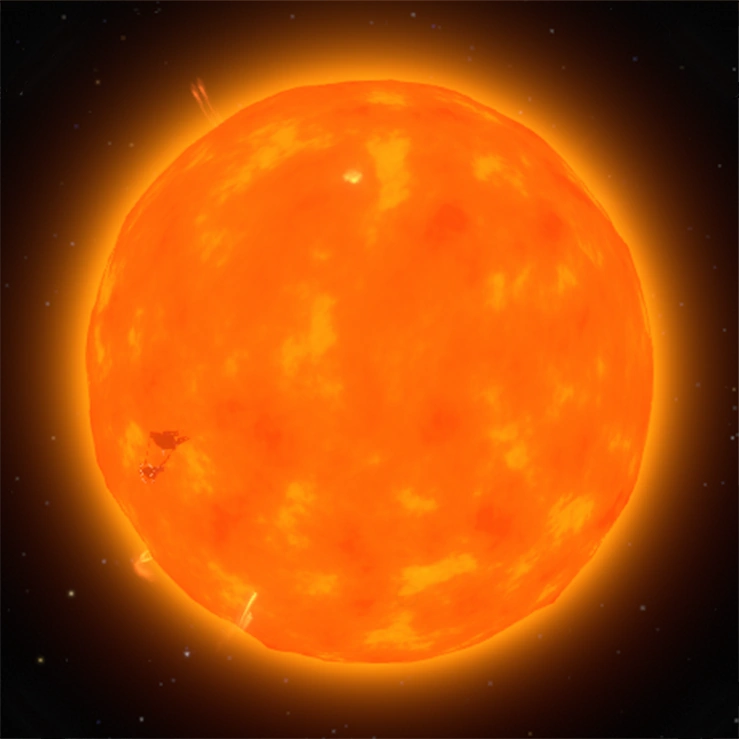<br><code>sun.png</code></td>
    <td align="center"><b>2. Hourglass Twins</b><br>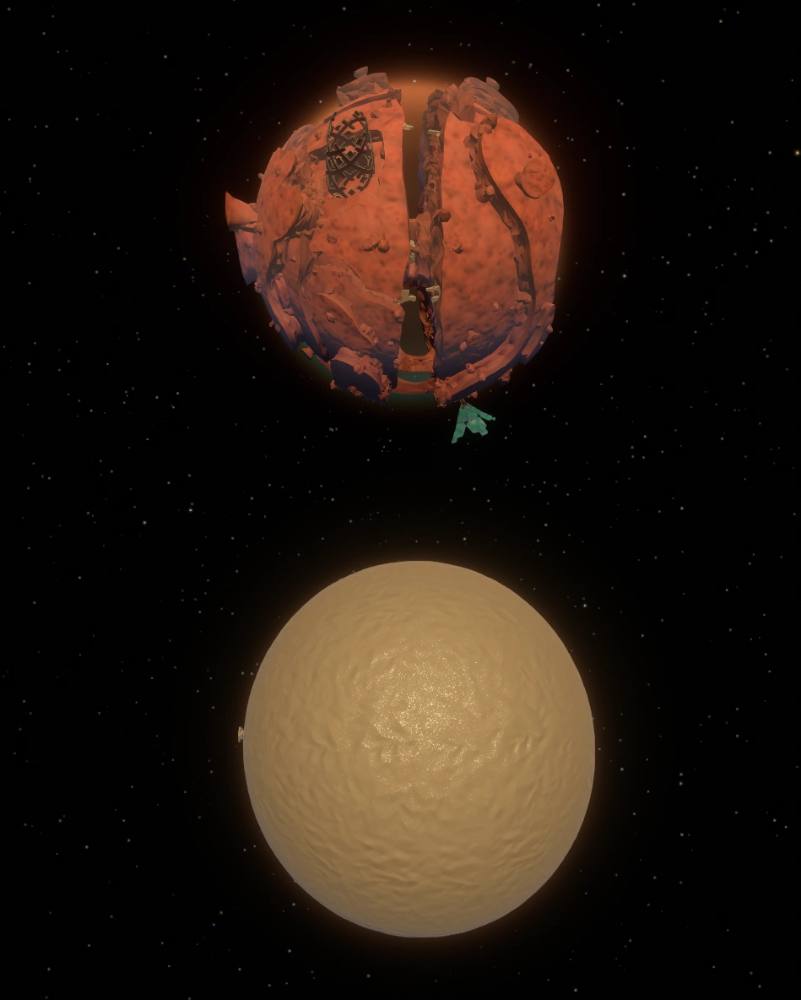<br><code>hourglass_twins.png</code></td>
    <td align="center"><b>3. Timber Hearth</b><br>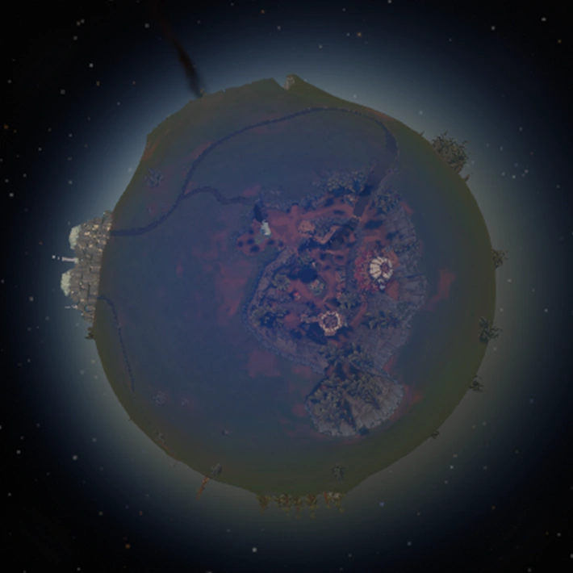<br><code>timber_hearth.png</code></td>
    <td align="center"><b>4. Attlerock</b><br>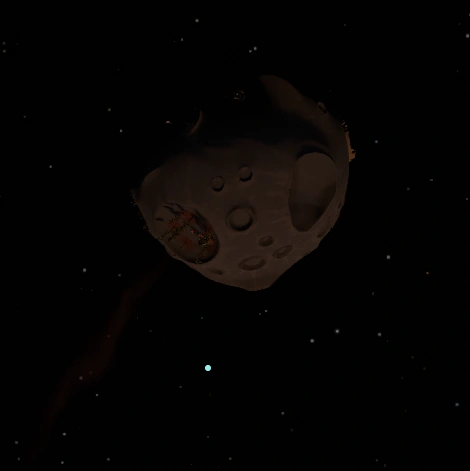<br><code>attlerock.png</code></td>
    <td align="center"><b>5. Brittle Hollow</b><br>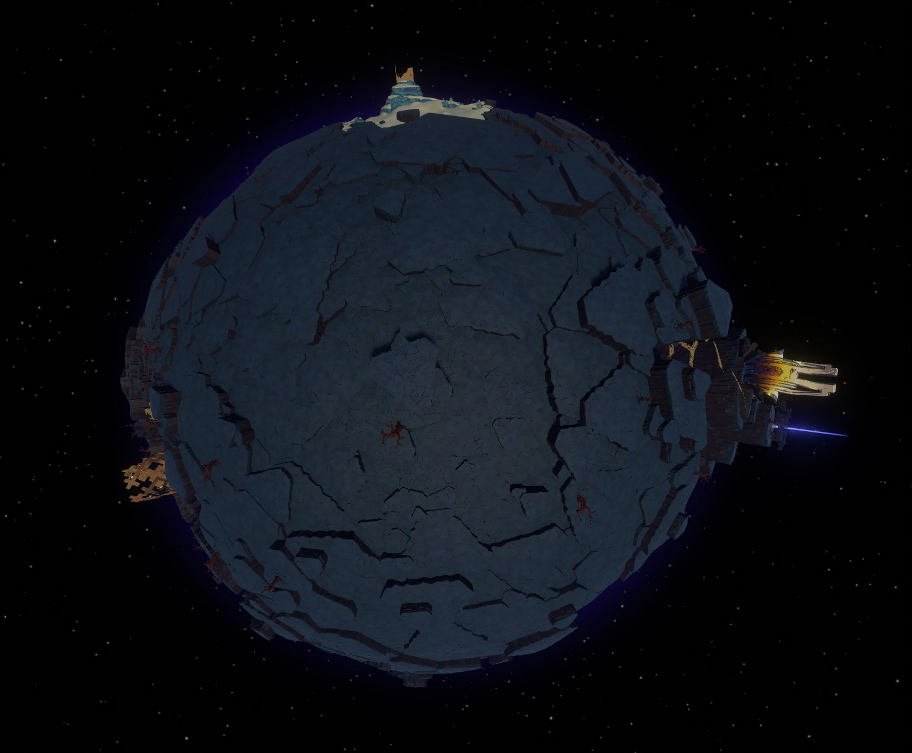<br><code>brittle_hollow.png</code></td>
    <td align="center"><b>6. Hollow's Lantern</b><br>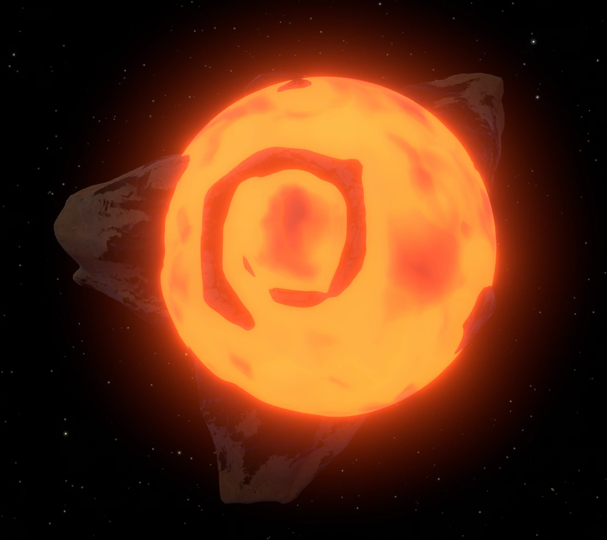<br><code>hollows_lantern.png</code></td>
  </tr>
  <tr>
    <td align="center"><b>7. Giant's Deep</b><br>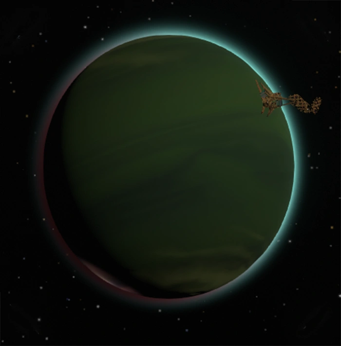<br><code>giants_deep.png</code></td>
    <td align="center"><b>8. Dark Bramble</b><br>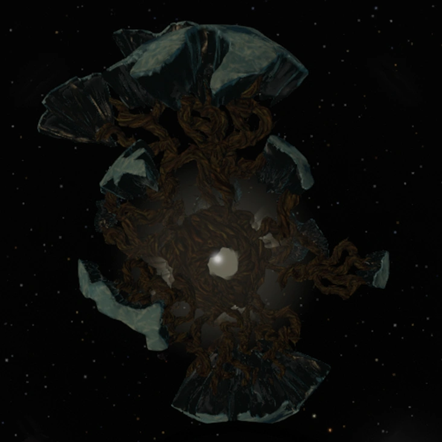<br><code>dark_bramble.png</code></td>
    <td align="center"><b>9. Interloper</b><br>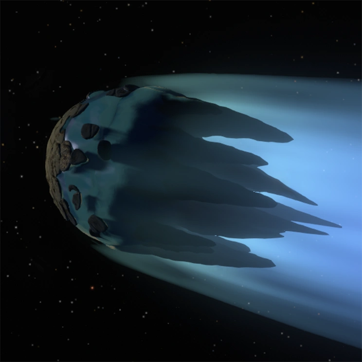<br><code>interloper.png</code></td>
    <td align="center"><b>0. Quantum Moon</b><br>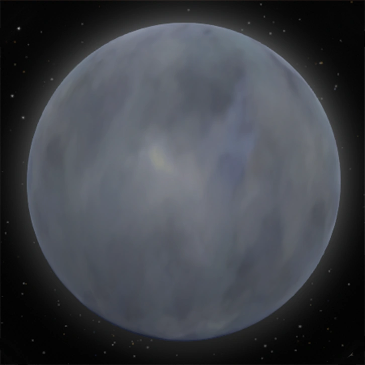<br><code>quantum_moon.png</code></td>
    <td align="center"><b>A. White Hole</b><br>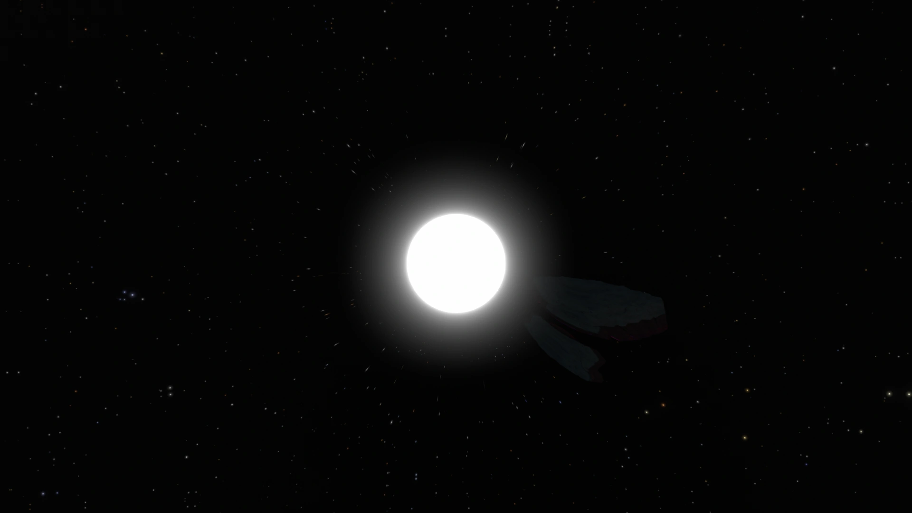<br><code>white_hole.png</code></td>
    <td align="center"><b>B. The Stranger</b><br>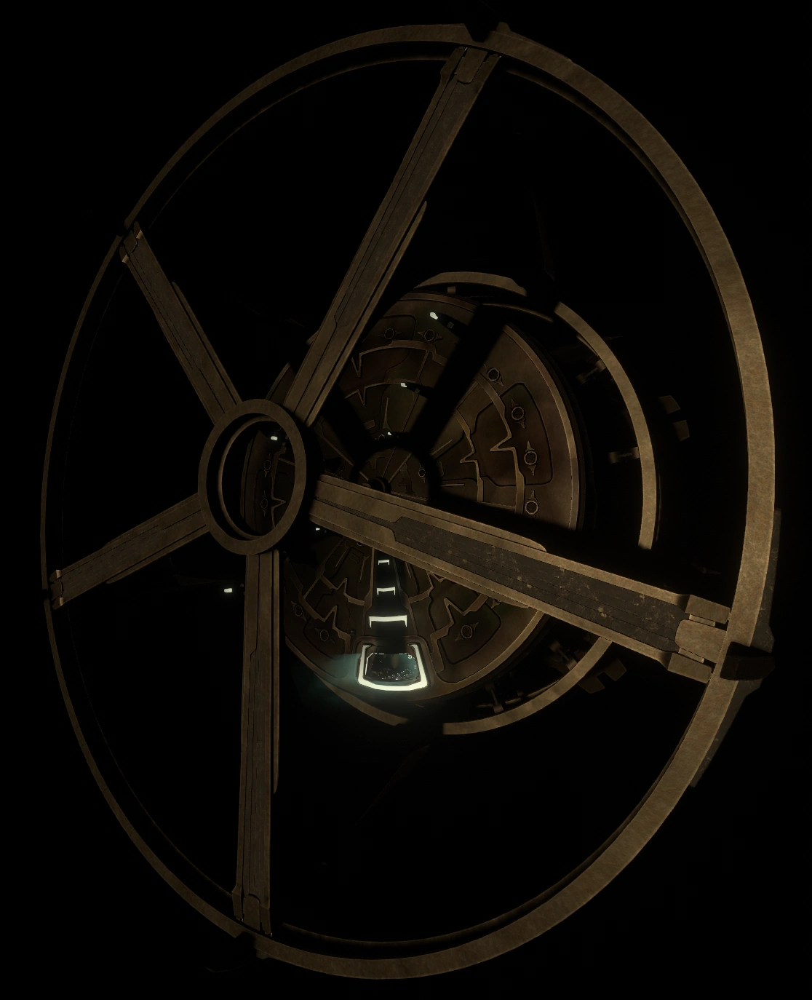<br><code>the_stranger.png</code></td>
  </tr>
</table>

---

## Принцип работы

Связь построена на стандарте **DTMF** — двухчастотных тональных сигналов. Каждому символу соответствует пара частот (низкая и высокая).

Передаётся идентификатор выбранной картинки:
1. Ноутбук-передатчик воспроизводит последовательность из 3 коротких тонов:
   * `*` (стартовый маркер, 180 мс)
   * Код картинки (`1`–`B`, 240 мс)
   * `#` (стоповый маркер, 180 мс)
2. Ноутбук-приёмник непрерывно анализирует сигнал с микрофона алгоритмом Гёрцеля, выделяя эти частоты.
3. При успешном получении кода программа сразу открывает соответствующую картинку из каталога.

Весь сеанс длится меньше секунды (~0.7 с).

---

## Запуск приложения

### Вариант 1. Готовая сборка (.exe)
Скачать архив с программой во вкладке [Releases](https://github.com/Ardi-013/polumecenev/releases), распаковать и запустить `lab1.exe` (установка Python не требуется).

### Вариант 2. Запуск из исходников
1. Установить менеджер пакетов [uv](https://docs.astral.sh/uv/).
2. В терминале перейти в директорию `lab1` и выполнить:
   ```bash
   cd lab1
   uv run lab1
   ```

---

## Сборка релиза (GitHub Actions)

В репозитории настроен процесс сборки `.github/workflows/lab1-release.yml`.

Запуск выполняется вручную через кнопку **Run workflow** во вкладке **Actions** на GitHub:
1. Скрипт считывает версию из `lab1/pyproject.toml`.
2. Извлекает описание изменений из `lab1/CHANGELOG.md`.
3. Собирает исполняемый файл под Windows с помощью PyInstaller (картинки планет включаются в сборку).
4. Упаковывает результат в архив `lab1-v<версия>-windows-x64.zip`.
5. Создаёт релиз в GitHub Releases с тегом `lab1-v<версия>` и прикрепляет архив.
