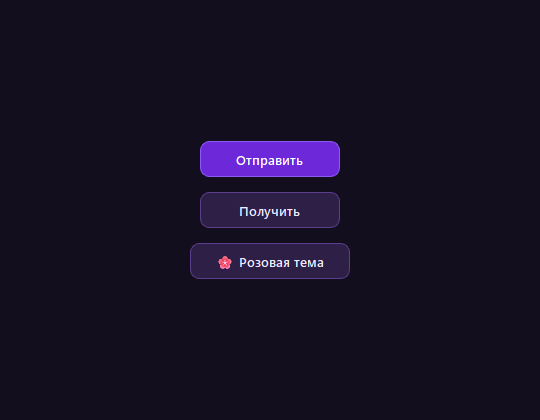
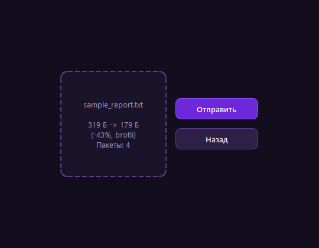
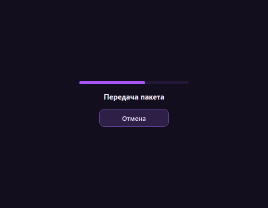
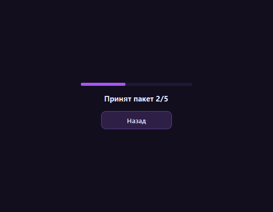
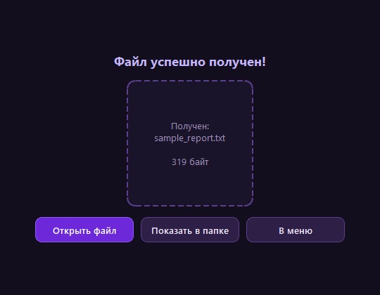

# Лабораторная работа №1: Акустическая передача файлов (Data-Over-Sound)

Программа для надёжной беспроводной передачи произвольных файлов любого формата (`*.*`) между компьютерами через звук (динамики и микрофон) без проводов, Wi-Fi и Bluetooth.

Система устойчива к комнатным акустическим помехам и реверберации, использует сжатие данных **Brotli**, помехоустойчивые коды **Рида-Соломона (ggwave)** и протокол подтверждения доставки **Stop-and-Wait ARQ**.

---

## Интерфейс приложения

### 1. Главное меню и цветовые темы
Приложение поддерживает две встроенные цветовые схемы (переключаются одной кнопкой):

<table>
  <tr>
    <td align="center"><b>🌙 Тёмно-фиолетовая тема (по умолчанию)</b><br></td>
    <td align="center"><b>🌸 Розовая тема</b><br></td>
  </tr>
</table>

### 2. Подготовка и отправка файла
При выборе файла вычисляется сжатие Brotli, процент экономии и число необходимых акустических пакетов. В процессе отправки отображается прогресс и статус текущего пакета:

<table>
  <tr>
    <td align="center"><b>Предварительный расчёт сжатия и пакетов</b><br></td>
    <td align="center"><b>Процесс передачи чанков в эфир</b><br></td>
  </tr>
</table>

### 3. Приём и результаты передачи
Приёмник непрерывно анализирует микрофонный вход и отсылает подтверждения `ACK`. По окончании передачи для получателя доступны кнопки прямого запуска файла и перехода в каталог сохранения:

<table>
  <tr>
    <td align="center"><b>Прослушивание эфира (Приёмник)</b><br></td>
    <td align="center"><b>Файл успешно получен (Действия с файлом)</b><br></td>
  </tr>
</table>

*(Также предусмотрен раздельный экран завершения для отправителя с кнопками «Показать в папке» и «В меню»).*

---

## Архитектура и стек технологий

1. **Предварительное сжатие — Brotli (RFC 7932):**
   * Использует статический словарь на 120 КБ (более 13 000 частых слов и языковых шаблонов).
   * Обеспечивает сжатие коротких текстовых файлов в 2–2.5 раза, прямо сокращая длительность звуковой передачи.
   * Если файл уже сжат или имеет бинарную природу, программа автоматически передаёт его без сжатия (`is_comp=False`).

2. **Физический акустический модем — `ggwave`:**
   * Модуляция множественным сдвигом частот (**MFSK**) в слышимой полосе 1.5–15 кГц.
   * Символы размером `SAMPLES_PER_FRAME = 512` (~10.6 мс) обеспечивают подавление межсимвольной интерференции (ISI) от отражений звука в комнате.
   * Аппаратная прямая коррекция ошибок **Рида-Соломона (FEC)** на уровне C-библиотеки: повреждённые шумом пакеты восстанавливаются математически.

3. **Канальный протокол — Stop-and-Wait ARQ:**
   * Файл нарезается на чанки фиксированного размера (52 байта).
   * Отправитель посылает пакет `DATA:seq` и ожидает ответный короткий кадр `ACK:seq` (тайм-аут 2.8 с).
   * При акустических помехах (кашель, клики) отправитель повторяет попытку (до 6 ретрансмитов).
   * Межкадровый защитный интервал (150 мс) позволяет угаснуть эху динамиков в помещении.
   * Итоговая проверка целостности собранного файла по контрольной сумме **CRC32**.

4. **Многопоточный GUI (PySide6 / Qt):**
   * Работа со звуковой картой (`sounddevice`) полностью изолирована в отдельных фоновых потоках `AudioSenderThread` и `AudioReceiverThread`, благодаря чему интерфейс остаётся отзывчивым.
   * Безопасная остановка потоков при отмене передачи без ложных срабатываний.
   * Системная интеграция с Windows:
     * **«Открыть файл»** — запуск через ассоциированную программу Windows (`os.startfile`).
     * **«Показать в папке»** — открытие Проводника с выделенным файлом (`explorer /select`).
     * Защита от перезаписи: сохраняемые файлы автоматически получают индекс (`file_1.txt`, `file_2.txt`).

---

## Запуск приложения

### Вариант 1. Запуск из исходников
1. Установите современный менеджер пакетов [uv](https://docs.astral.sh/uv/).
2. В терминале перейдите в папку `lab1` и выполните:
   ```bash
   cd lab1
   uv run lab1
   ```
   *(Или `uv run python -m lab1.main`)*. Все необходимые зависимости (`pyside6`, `sounddevice`, `ggwave`, `brotli`, `numpy`) установятся автоматически.

### Вариант 2. Запуск готового `.exe`
Скачайте готовый архив в разделе [Releases](https://github.com/Ardi-013/polumecenev/releases), распакуйте и запустите `lab1.exe` (установка Python не требуется).

---

## Автоматическая сборка (CI/CD)

В репозитории настроен GitHub Actions workflow [lab1-release.yml](../.github/workflows/lab1-release.yml), собирающий автономный исполняемый файл под Windows с помощью PyInstaller:
1. Считывает текущую версию из `pyproject.toml`.
2. Извлекает свежие заметки релиза из `CHANGELOG.md`.
3. Собирает бинарный дистрибутив `lab1.exe` без внешних зависимостей.
4. Упаковывает артефакт в zip-архив и публикует релиз на GitHub.
